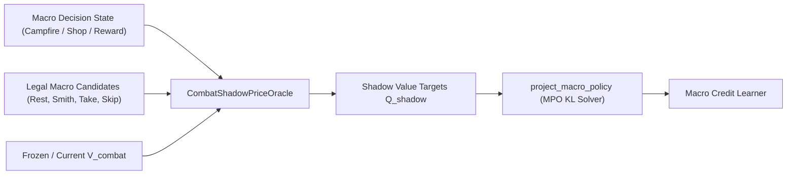

# Macro-Combat Resource Shadow Price v1

Status: IMPLEMENTED. Target branch: `feature/macro-combat-shadow-price`.

This document establishes the normative mathematical and architectural specification
for replacing heuristic temporal macro horizons (`next_resource_opportunity` and
unbounded counterfactual rollout loops) with **authoritative Combat Resource Shadow
Pricing** derived from the combat value network $V_{\text{combat}}$.

---

## 1. Context & First Principles

In Slay the Spire, gameplay operates on two distinct yet deeply coupled physical scales:
1. **Combat (Tactical Micro)**: High-frequency, closed-loop, immediate turn-by-turn execution.
   The value network $V_{\text{combat}}(S)$ is trained across millions of interactions to predict
   the expected discounted survival and success from a given physical state $(R, D)$ entering battle,
   where $R$ denotes scalar resources (HP, Max HP, Gold) and $D$ denotes deck multiset composition.
2. **Economy (Strategic Macro)**: Low-frequency, discrete resource mutations at Rest sites, Shops,
   and Card Rewards. Each macro candidate $a \in \mathcal{A}_{\text{macro}}$ produces an immediate,
   deterministic resource mutation:
   $$\Delta R(a) = (\Delta \text{HP}(a), \Delta D(a), \Delta \text{Gold}(a))$$

### The Failure of Heuristic Horizon Slicing
Previous iterations (v47 and synchronous macro-credit courses) attempted to evaluate macro actions
by accumulating returns across an artificial temporal horizon:
- `next_resource_opportunity` truncated credit arbitrarily at the next campfire/shop/reward, ignoring
  intervening combat survival differentials.
- Counterfactual multi-encounter rollouts introduced massive Monte-Carlo variance, high compute
  overhead, and noisy downstream sampling.

### The First-Principles Solution: Shadow Pricing
From constrained optimization and microeconomic duality:
The combat value function $V_{\text{combat}}$ is the **authoritative pricing oracle** for resources
entering battle.
Instead of rolling out future encounters or truncating arbitrarily, a macro action's downstream value
is directly quantified by the **marginal combat utility (Shadow Price)** of the resources it modifies:

$$\lambda_{\text{HP}} = \frac{\partial V_{\text{combat}}}{\partial \text{HP}} \ge 0$$

For discrete deck mutations (upgrades $c \to c^+$, removals $D \setminus \{c\}$, additions $D \cup \{c\}$),
the shadow differential is the exact counterfactual combat evaluation:

$$\Delta V_{\text{deck}}(a) = V_{\text{combat}}(S[\text{Deck} \oplus \Delta D(a)]) - V_{\text{combat}}(S)$$

Thus, any macro candidate $a$ has a well-defined, instantaneous, causally-closed value target:

$$Q_{\text{shadow}}(S, a) = R_{\text{immediate}}(a) + \gamma \cdot \left[ V_{\text{combat}}(S) + \Delta V_{\text{HP}}(a) + \Delta V_{\text{deck}}(a) \right]$$

---

## 2. Non-Negotiable Invariants

1. **No Handcrafted Heuristic Rules**:
   - No hardcoded HP thresholds (e.g. `if hp < 0.5 rest else smith`).
   - No static card tier lists or preference weights.
   - The trade-off between resting and upgrading must emerge purely from $\Delta V_{\text{HP}}$ versus
     $\Delta V_{\text{deck}}$ evaluated under $V_{\text{combat}}$.
2. **Physical Monotonicity of Shadow Prices**:
   - $\lambda_{\text{HP}} \ge 0$: Additional HP cannot decrease survival probability.
   - Diminishing marginal utility: At low HP, $\lambda_{\text{HP}}$ is strictly larger than at near-maximum HP.
3. **Exact Permutation Invariance**:
   - Card additions, removals, and upgrades modify the multiset canonical representation without
     altering entity order or candidate-position identities.
4. **Zero Taylor Truncation Error for Discrete Mutations**:
   - Deck mutations are evaluated directly by counterfactual state re-encoding through the combat stream,
     guaranteeing exact non-linear threshold capture (e.g. key combo cards, curse removal).

---

## 3. Mathematical Formulation

### 3.1 HP Shadow Price (Continuous Sensitivity)
Let $x_{\text{HP}} \in [0, 1]$ be the normalized current HP feature in the player's structural feature vector
$F_{\text{player}} \in \mathbb{R}^{d_{\text{feature}}}$. The scalar state value under the combat stream is:
$$V_{\text{combat}} = \text{ValueHead}(\text{JointStream}(\text{CombatStream}(F_{\text{world}}), \text{Memory}))$$

The analytical shadow price is obtained via autograd:
$$\lambda_{\text{HP}} = \frac{\partial V_{\text{combat}}}{\partial x_{\text{HP}}}$$

For an action providing healing $\Delta \text{HP}$ (e.g. Rest healing 30% of Max HP):
$$\Delta V_{\text{HP}}(\text{Rest}) = V_{\text{combat}}(S[\text{HP} + \Delta \text{HP}]) - V_{\text{combat}}(S)$$
which asymptotically converges to $\lambda_{\text{HP}} \cdot \Delta x_{\text{HP}}$ for infinitesimal changes,
while capturing exact death-boundary saturation for finite heals.

### 3.2 Deck Mutation Shadow Value (Discrete Difference)
For card actions:
- **Smith / Upgrade**: $\Delta D = \{c^+ \text{ count} + 1, c \text{ count} - 1\}$.
- **Card Reward (Take $c$)**: $\Delta D = \{c \text{ count} + 1\}$.
- **Card Reward (Skip)**: $\Delta D = \emptyset \implies \Delta V_{\text{deck}}(\text{Skip}) = 0$.
- **Shop Removal**: $\Delta D = \{c \text{ count} - 1\}$.

If a card $c$ is detrimental to combat survival (e.g. diluting key defenses in a fragile deck):
$$V_{\text{combat}}(S[\text{Deck} \cup \{c\}]) < V_{\text{combat}}(S) \implies \Delta V_{\text{deck}}(\text{Take } c) < 0 = \Delta V_{\text{deck}}(\text{Skip})$$
The policy naturally learns **"Cannot Say No" rejection** directly from combat value gradients without
needing an exploration corridor or reward bonus for skipping.

---

## 4. Architecture & Interface

- **`CombatShadowPriceOracle`**:
  Located in `sts2_rl.joint.shadow_price`.
  Encapsulates autograd sensitivity computation and counterfactual delta evaluation through the model's
  combat representation.
- **`project_macro_policy`**:
  Takes $Q_{\text{shadow}}$ as `action_value_targets` and solves the KL-regularized posterior projection
  $q(a) \propto \pi_{\text{teacher}}(a) \exp(Q_{\text{shadow}}(a) / \eta)$.
- **`MacroCreditLearner`**:
  Supports `target_mode = "combat_shadow_price"`, directly updating macro policy heads against $q(a)$
  without waiting for long multi-encounter rollouts.
